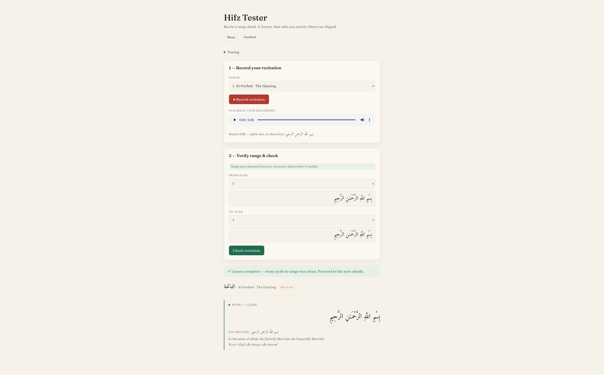

# Hifz Tester

A local, single-user tool that plays the role of the listening teacher in *hifz*
(Quran memorization): you recite a chosen range of ayahs, it transcribes you on
the server, and it tells you — **at the level of the individual word** — whether
you recited correctly or exactly where you slipped. Next.js + TypeScript on the
front, a Quran-fine-tuned Whisper model on the back. Nothing leaves your machine
at inference time.

**Live version:** [hifz.foyzul.com](https://hifz.foyzul.com)



It is focused on one thing done well: **word-level correctness with precise
pinpointing.** It does not grade tajweed, and it works in record-then-review mode
(recite the whole range, then get feedback), not live interruption.

## How it works

```
  browser: record mic ─▶ decode + resample to 16 kHz mono ─▶ POST /api/transcribe
                                                              │
   server: warm Whisper model (Python FastAPI worker) ─▶ transcript
                                                              │
          auto-detect surah range ◀──────────────────────────┤
                                                              │
          POST /api/verify (transcript + range)               │
                                                              │
          reference ayah text ─▶ normalize ◀── normalize ◀───┘
                                     │
                                   align  (deterministic, tolerant)
                                     │
                           per-ayah verdict + pinpointed word ─▶ UI
```

Three ideas carry the project:

1. **The verdict is decided in code, never by an LLM.** The reference text is
   known, so this is a *verification* problem, not a generation one. A
   deterministic word-level alignment gives a reproducible, inspectable answer —
   the same recitation always yields the same verdict.
2. **Transcription and verification are split.** ASR runs once when you stop
   recording and fires in the background — by the time you finish adjusting the
   range and click **Check recitation**, the transcript is already waiting. The
   verification step (`/api/verify`) is pure text-vs-text, so re-checking against
   a different range or threshold costs nothing.
3. **The Python speech model is called from Node over a warm, long-lived
   worker** — loaded once, reused across requests, behind a stable transport
   seam. This is the most interesting engineering in the repo, written up in the
   docs below.

## Quick start

Requirements: Node.js 18.18+ (20+ recommended), Python 3, and a microphone used
from the browser.

```bash
npm install
pip install fastapi uvicorn transformers torch numpy
```

You need two processes running side by side:

```bash
# Terminal 1 — Next.js
npm run dev

# Terminal 2 — FastAPI ASR worker (Whisper loads here)
npm run dev:asr
```

Open <http://localhost:3000>, pick a surah, record your recitation, and press
**Check recitation**. The app auto-detects the ayah range from your transcript —
confirm or adjust it before checking.

> **First run downloads the model** (~3 GB for the default
> `IJyad/whisper-large-v3-Tarteel`; 30–60 s to load into memory). Subsequent
> runs reuse the HuggingFace cache. Override the model with
> `HIFZ_ASR_MODEL=<hf-model-id>` before starting the worker.

The Python worker auto-selects the best available device: CUDA (NVIDIA) → MPS
(Apple Silicon) → CPU. No extra config needed.

### Remote or LAN ASR worker

If you're running the ASR worker on a different machine:

```bash
HIFZ_ASR_FASTAPI_URL=http://<ip>:8765/transcribe npm run dev
```

## User flow

1. **Record** — recite aloud (up to 60 seconds). Transcription starts in the
   background immediately when you stop, so you can adjust the range in parallel.
2. **Auto-detect** — the app matches the transcript against the Quran text and
   pre-fills the most likely ayah range. Adjust if needed.
3. **Check recitation** — runs the deterministic alignment against your chosen
   range. Changing the range or tolerance and re-checking does not re-run ASR.
4. **Review** — each ayah shows a clean / needs-review verdict with:
   - the reference Arabic text, with mistaken words highlighted
   - what you actually recited (from the ASR)
   - pinpointed notes: substitution, omission, or insertion, by word number
5. **Retry** — if transcription failed, a **Retry transcription** button
   re-submits the last recording without re-recording.

## Documentation

- **[docs/architecture.md](docs/architecture.md)** — the system as it is now:
  data flow, module map, and the deterministic verification engine.
- **[docs/node-python-ipc.md](docs/node-python-ipc.md)** — **the good part**: how
  Node calls the Python model over a warm TCP-loopback worker, why that beats
  spawning Python per request, and the stdio fallback that also ships.

## Tuning

Match tolerance lives in the **Tuning** panel (slider, 0.50–0.98, per session)
and `SIMILARITY_THRESHOLD` in `src/lib/align.ts` (compile-time default `0.80`).
Flagging words you recited correctly? Lower it. Letting real mistakes slip? Raise
it. It can only be dialed in against *your* voice and *your* model — record a few
ranges you know cold and adjust.

## Tests

```bash
npm test          # deterministic core + FastAPI integration
npm run test:core # core only — no model, no audio required
```

The trustworthy core is fully tested without the model or any audio: diacritic
folding, near-miss tolerance, range auto-detection, and that substitutions,
omissions, and insertions are pinpointed to the correct ayah and word — end to
end over the real Al-Fatihah text.

## Limitations

- **Word-level only** — it checks which words you recited, not tajweed.
- **Batch, not live** — recite the full range, then review.
- **ASR false positives are the main risk** — normalization, tolerant alignment,
  and the threshold slider manage this; a specialised model plus tuning are what
  make it usable.
- **Scope:** Hafs ʿan ʿĀsim; plain-script reference (diacritics ignored for
  matching).

## Roadmap

- **In-browser ASR:** run a smaller model client-side via WebGPU for a
  zero-backend, fully-offline variant.

## Contributing

- The **deterministic core** (`normalize.ts`, `align.ts`, `session.ts`,
  `detect-range.ts`) is the trustworthy heart of the app and is tested without a
  model or audio. Keep `npm run test:core` green and add a case when you change
  it.
- The verdict stays **in code, never in an LLM** (see the architecture doc). PRs
  that move correctness judgement into a model will be redirected.
- Run `npm run typecheck` and `npm run lint` before opening a PR.

## License

MIT — see [LICENSE](LICENSE).
